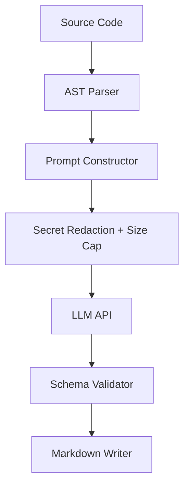

<p align="center">
  <a href="#quickstart"><strong>Quickstart</strong></a> &middot;
  <a href="#before-and-after"><strong>Before and after</strong></a> &middot;
  <a href="#how-it-works"><strong>How it works</strong></a> &middot;
  <a href="#use-it-in-ci"><strong>CI</strong></a>
</p>

<p align="center">
  
  
  
  
</p>

<br>

# AutoDocs writes your TypeScript docs from the code itself.

Markdown docs from `.ts` and `.tsx` files: AST extraction, then schema-checked LLM output.

**If your code is the _source of truth_, AutoDocs is the _clerk_ who copies it out every time it changes.**

Teams ship components faster than they write docs. The docs drift, the examples go stale, and
review slows down. AutoDocs reads each file's exports with an AST, asks Claude to describe them,
checks the answer against a schema, and writes markdown. It only redoes files that changed.

**Stop hand-editing docs that already drifted.**

|        | Step        | Example                                                         |
| ------ | ----------- | --------------------------------------------------------------- |
| **01** | Install     | _`npm install && npm run build`_                                |
| **02** | Try it free | _`node dist/index.js --mock ./examples/sample-input --out ./docs`_ |
| **03** | Go live     | _Set `ANTHROPIC_API_KEY`, then `npm run autodocs -- generate`._ |

> [!TIP]
> **📄 Or hand it to your agent.** Paste this into Claude Code or Codex:
>
> ```text
> Clone https://github.com/Wasif-ZA/AutoDocs, run `npm install` and `npm run build`,
> then `node dist/index.js --mock ./examples/sample-input --out ./docs` and show me one page it wrote.
> ```

<br>

## AutoDocs is right for you if

- ✅ Your **docs drift** from the code within a sprint
- ✅ You want docs built from **real signatures and types**, not guesses
- ✅ You want **CI** to regenerate docs without a key in mock mode
- ✅ You do not want **secrets or env reads** sent to a model

<br>

## Before and after

**Before**

```ts
export const truncate = (input: string, maxLength: number): string => {
  const symbols = Array.from(input);
  if (symbols.length <= maxLength) return input;
  return `${symbols.slice(0, maxLength - 1).join('')}…`;
};
```

**After**

```md
## truncate (function)
Truncates a string by Unicode symbols and appends a single ellipsis when truncation occurs.

| Name | Type | Description |
| --- | --- | --- |
| `input` | `string` | String to shorten. |
| `maxLength` | `number` | Maximum number of symbols to keep including ellipsis when truncation is needed. |

**Returns** `string`: Original string when short enough, otherwise a symbol-safe truncated string ending with an ellipsis.
```

<br>

## Problems AutoDocs solves

| Without AutoDocs | With AutoDocs |
| --- | --- |
| ❌ Docs describe last month's function signature. | ✅ Each run reads the current exports with ts-morph. |
| ❌ A model invents a parameter that does not exist. | ✅ Output is checked with zod; mock responses must name only exports the AST finds. |
| ❌ An API key in a file ends up in a prompt. | ✅ Key-like strings and `process.env` reads are stripped first. |
| ❌ Every run re-documents the whole repo. | ✅ A sha256 manifest skips unchanged files: a second mock run prints `4 unchanged`. |
| ❌ A 529 from the API fails the build. | ✅ Rate limits, timeouts, 503 and 529 are retried. |

<br>

## Why AutoDocs is different

|                             |                                                                     |
| --------------------------- | ------------------------------------------------------------------- |
| **AST, not raw text.**      | Signatures, types and export intent come from the parser.           |
| **Schema-checked output.**  | A response that does not fit the schema is rejected.                |
| **Redacted and capped.**    | Each file is cut to `security.maxFileChars`, head and tail kept.    |
| **A mock mode.**            | Deterministic, no network, no key. Good for CI.                     |

<br>

## How it works



<details>
<summary>Open: the two entry points and the source layout</summary>

| Entry point | What it does | Needs a key? |
| --- | --- | --- |
| `node dist/index.js --mock <dir>` | Documents every `.ts`/`.tsx` module in `<dir>` from canned responses in `mock-responses.json`. | No |
| `npm run autodocs -- generate` | Documents React components found by `autodocs.config.ts` with Claude and writes `.mdx` pages plus an index. | `ANTHROPIC_API_KEY` |

- `src/index.ts`: mock-mode CLI, bundled to `dist/index.js`.
- `src/generate.ts`: export extraction, response schema check, markdown, hash manifest.
- `scripts/autodocs/cli/`: live CLI (`generate`, `validate`, `cache`, `init`).
- `scripts/autodocs/core/`: component AST extraction, Claude calls with retry, Handlebars MDX, example validation.
- `scripts/autodocs/config/`: zod config schema and `autodocs.config.ts` loading.
- `scripts/autodocs/utils/`: response cache, rate limiting, secret redaction, logging.

The live CLI caches responses by content and model hash under `.autodocs/cache`.

</details>

<br>

## Quickstart

```bash
git clone https://github.com/Wasif-ZA/AutoDocs
cd AutoDocs
npm install
npm run build
node dist/index.js --mock ./examples/sample-input --out ./docs
```

Responses come from `<inputDir>/../mock-responses.json` unless you pass `--responses <file>`.
Run from an installed checkout (`npm ci`, not `--omit=dev`): `dist/index.js` loads ts-morph and
zod from `node_modules`.

### Live mode

```bash
export ANTHROPIC_API_KEY=...
npm run autodocs -- generate --dry-run
npm run autodocs -- validate src/components/Button.tsx   # AST only, no key
```

Point `paths.components` in `autodocs.config.ts` at your component folder first.

| Variable | Required | Purpose |
| --- | --- | --- |
| `ANTHROPIC_API_KEY` | Live mode | Claude calls from `generate`. |
| `AUTODOCS_MODEL` | No | Override `llm.model`. |
| `AUTODOCS_OUTPUT_DIR` | No | Mock output folder when `--out` is not given (default `./docs`). |

## Use it in CI

```yaml
- name: Build
  run: npm run build

- name: Generate docs in mock mode
  run: node dist/index.js --mock ./examples/sample-input
```

## Roadmap

- ⬜ Failover across model backends, with health scoring
- ⬜ Framework-specific examples (React, Node, SDK clients) from one schema
- ⬜ A Docker image with a pinned runtime and workflow templates

Tests: `npm run typecheck` and `npm run test:run`.

## License

MIT (declared in `package.json`).
